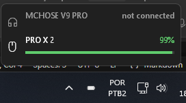

# wireless-battery-summary

**See the battery level of your wireless mouse, headset, earbuds, keyboard, and controller in one Windows 11 tray icon.** Click it for a popup with every device. No need to open G HUB or Bluetooth settings.

A fork of [windows-taskbar-battery](https://github.com/renanleonel/windows-taskbar-battery) by Renan Leonel, reworked from a per-device taskbar widget into a single notification-area icon with a flyout. The binary is still `taskbar-battery.exe`.



- **Automatic:** detects Logitech wireless devices, Bluetooth devices, and Xbox/PlayStation controllers on its own, with nothing to configure.
- **Lightweight:** a single ~600 KB executable written in Rust. It uses only a few MB of memory, has no installer or runtime dependencies (not even the Visual C++ runtime), and sits idle between checks.
- **Accurate:** for Logitech devices that report a voltage, it uses G HUB's own battery curves (when G HUB is installed), so the percentages match what G HUB shows.
- **Native look:** follows the light/dark theme, scales with DPI, and uses Windows' own Fluent icons.
- **Low battery warnings:** a red badge appears on the tray icon when a device drops to 20%; at 10% the icon switches to that device's own icon in red. A Windows notification is also sent at 15%.
- **Private:** everything stays on your PC. There are no network requests, no telemetry, and no accounts.

---

## Contents

- [Supported devices](#supported-devices)
- [Install](#install)
- [Using it](#using-it)
- [How it works](#how-it-works)
- [Troubleshooting](#troubleshooting)
- [Limitations](#limitations)
- [Uninstall](#uninstall)
- [Build from source](#build-from-source)
- [Contributing](#contributing)
- [Credits](#credits)

---

## Supported devices

| Connection | Devices | How the battery is read |
|---|---|---|
| **Logitech receivers**: Lightspeed, Unifying, Bolt | Mice, keyboards, and anything else paired to the receiver | Logitech's HID++ protocol, over the receiver |
| **Logitech dongles** | Wireless headsets (e.g. PRO X Wireless, G series) | HID++, directly over the dongle |
| **Bluetooth LE** | Most Bluetooth mice, keyboards, and gamepads | Standard GATT Battery Service |
| **Classic Bluetooth** | Headphones and earbuds (AirPods, Galaxy Buds, Sony…) | The battery level the device reports to Windows, the same value Settings › Bluetooth shows |
| **Xbox controllers** | Xbox One / Series and other XInput controllers, over the Xbox Wireless adapter, Bluetooth, or USB | Windows.Gaming.Input battery report (exact capacity) |
| **PlayStation controllers** | DualSense, DualSense Edge, DualShock 4, over USB or Bluetooth | The controller's own input report |
| **Delux mice** | Delux and other 2.4 GHz mice on the Xenta dongle (USB ID 1D57:FA60) | The dongle's status report (charging state not detected) |
| **MCHOSE headsets** | V9 PRO and other headsets on the MCHOSE dongle (USB ID 291D:385D) | Vendor battery report on the dongle's `0xFF90` HID collection |
| **Other headsets** via [HeadsetControl](#other-headsets-headsetcontrol) | SteelSeries Arctis, HyperX Cloud, Corsair, Audeze, Logitech G and more | HeadsetControl, if installed (optional) |

### Tested on real hardware

| Device | Connection | Status |
|---|---|---|
| Logitech G Pro Wireless (mouse) | Lightspeed receiver | ✅ matches G HUB |
| Logitech PRO X Wireless (headset) | USB dongle | ✅ matches G HUB |
| Logitech PRO X Superlight 2 (mouse) | Lightspeed receiver (046D:C54D) | ✅ |
| Logitech G502 X PLUS (mouse) | Lightspeed receiver (046D:C547) | ✅ |
| MCHOSE V9 PRO (headset) | 2.4 GHz dongle (291D:385D) | ✅ percentage + charging state |
| Apple AirPods | Classic Bluetooth | ✅ |
| Delux wireless mouse | 2.4 GHz dongle (1D57:FA60) | ✅ matches the Delux app (±2%) |
| Bluetooth LE mouse/keyboard | Bluetooth LE | ⚠️ implemented, not yet tested on hardware |
| Xbox / PlayStation controllers | all | ⚠️ implemented, not yet tested on hardware |
| HeadsetControl headsets | USB dongle | ⚠️ implemented, not yet tested on hardware |

Using a device that isn't listed? Please [open a device report](../../issues/new?template=device_report.yml) saying whether it works, so it can be added to the table.

### Other headsets (HeadsetControl)

[HeadsetControl](https://github.com/Sapd/HeadsetControl) supports dozens of headsets that use proprietary USB dongles: SteelSeries, HyperX, Corsair, Audeze, Roccat, and more. taskbar-battery uses it automatically if it finds it:

1. Download `headsetcontrol-windows-x86_64.exe` from [HeadsetControl's releases](https://github.com/Sapd/HeadsetControl/releases/latest).
2. Put it **in the same folder as `taskbar-battery.exe`**, or anywhere on your `PATH`. You can also use its installer, which adds it to `PATH`.
3. Restart taskbar-battery (right-click → Exit, then start it again).

It runs as a separate program every 60 s and isn't bundled. Its GPL license doesn't apply to this project. Logitech headsets that taskbar-battery already reads itself aren't listed twice.

### Not supported (yet)

Razer, Corsair, and other **2.4 GHz mouse/keyboard dongles** each use their own undocumented protocol. They will show up if they're connected over Bluetooth, but not through their USB dongles. See [Contributing](#contributing) if you want to add one. For many of them, [Wireless-Device-Battery-Monitor](https://github.com/krisgfx9/Wireless-Device-Battery-Monitor) already works.

---

## Install

1. Download **`taskbar-battery.exe`** from the [latest release](../../releases/latest).
2. Move it to a permanent folder. The recommended location is:
   ```
   %LOCALAPPDATA%\Programs\taskbar-battery\
   ```
   It registers itself to start with Windows from wherever it is, so don't run it from your Downloads folder.
3. Double-click it. A battery icon appears in the notification area (system tray). On Windows 11 it may start inside the **^** overflow — drag it onto the taskbar, or enable it under *Settings › Personalization › Taskbar › Other system tray icons*. Click it to see every device.

> **Windows SmartScreen warning?** The exe isn't code-signed (certificates cost money), so on first run Windows may say *"Windows protected your PC"*. Click **More info → Run anyway**. You can also [build it from source](#build-from-source) yourself.

**Requirements:** Windows 11. Windows 10 may work but is untested. G HUB is optional.

---

## Using it

### Reading the tray icon

| What you see | Meaning |
|---|---|
| Battery glyph | Every device is above 20% |
| Battery glyph + **red badge** | At least one device is at 20% or below |
| **Red device icon** (mouse, headset, …) | A device is at 10% or below. The lowest one wins |
| **⚡** nowhere | Charging devices never trigger warnings |

Warnings clear a couple of points above their threshold (22% / 12%) so the icon doesn't flicker around the limit.

**Hover** the icon for a one-line summary of every device. **Click** it to open the popup — it slides up from the icon and closes when you click away: one row per device with its icon, name, percentage, and a bar. Devices that are asleep show their last known level, dimmed — the battery doesn't change while a device sleeps. Devices hidden in the menu don't appear.

The same device reachable two ways at once — a charging cable plus its wireless dongle, or BLE plus classic Bluetooth — shows up as one entry.

### Right-click menu

Right-click the tray icon to see:

- **Every detected device** with its current level, including disconnected ones. Uncheck a device to hide it from the popup, check it again to bring it back.
- **Display:** tray icon + popup (the default) or the original per-device strip embedded in the taskbar.
- **Refresh now:** checks all devices immediately.
- **Low battery alerts:** a Windows notification when a device drops to 15%, sent once per discharge. It re-arms after the device is charged or climbs above 20%. On by default.
- **Start with Windows:** turn launching at login on or off. It's on by default.
- **Copy diagnostics:** puts the diagnostics log on the clipboard, for device reports.
- **Exit**

### The taskbar strip

Prefer the upstream look — every device's icon and percentage sitting directly in the taskbar? Right-click → **Display → Device strip (taskbar)**:


It shows the charging bolt, dimmed levels for sleeping devices, and red when a battery runs low:


The strip relies on undocumented taskbar internals, so a Windows update can break its placement — that's why the tray icon is the default. Right-clicking the strip opens the same menu.

### How often it updates

| Source | Interval |
|---|---|
| Logitech, MCHOSE, Delux, Xbox, and PlayStation controllers | every 15 s |
| Bluetooth | every 60 s (reading wakes the device's radio, so it's polled less often) |
| HeadsetControl | every 60 s (it runs as a separate process) |
| Any USB device plugged in or out | immediately |
| PC wakes from sleep | immediately |

### Sleeping devices

Logitech mice and keyboards go to sleep after a short idle period and stop answering. While asleep, the app keeps showing the **last known level, dimmed**, because the battery doesn't change while a device sleeps — and the stale level can still trigger the low-battery badge. Each check retries a timed-out query once, so a packet dropped while the device's radio is busy (e.g. you're moving the mouse) doesn't get mistaken for sleep.

A device that's switched off looks the same to the receiver as one that's asleep, so it also keeps its last reading. A headset that's switched off is detected as off and removed from the popup.

---

## How it works

### The tray icon

taskbar-battery uses `Shell_NotifyIcon`, the documented notification-area API — no taskbar internals involved, so Windows updates can't break the layout.

- The icon is rendered at runtime from Fluent glyphs: a battery glyph normally, the lowest device's own glyph in red when it's critical, plus a procedural red badge for warnings. It follows the light/dark theme and DPI.
- The popup is a borderless tool window (no taskbar button), anchored to the icon's on-screen rect via `Shell_NotifyIconGetRect`. It slides in from the icon's direction on open and closes when it loses focus.
- If Explorer restarts (crash, or `taskkill /f /im explorer.exe`), the icon is re-added when the new taskbar appears.

### Logitech (HID++)

Logitech wireless devices speak **HID++**, a protocol tunneled through vendor-defined HID reports. taskbar-battery:

1. Finds every Logitech HID++ interface: receivers (up to 6 paired devices each) and direct dongles.
2. Asks each device which battery feature it supports:

   | Feature | Name | Returns |
   |---|---|---|
   | `0x1004` | Unified Battery | percentage + charging state |
   | `0x1000` | Battery Status | percentage + charging state |
   | `0x1001` | Battery Voltage | millivolts (most Lightspeed gaming mice) |
   | `0x1F20` | ADC Measurement | millivolts (headsets) |

3. Reads the device's name and type (`0x0005`) and its model IDs (`0x0003`).
4. For voltage-only devices, converts millivolts to a percentage. If G HUB is installed, it uses G HUB's per-device discharge curve from `C:\ProgramData\LGHUB\depots\…\*battery*.xml`, so the numbers match G HUB exactly. Otherwise it uses a generic Li-ion curve, which is usually within a few percent.

It works alongside G HUB: requests are tagged with their own software ID, so the two don't interfere. G HUB doesn't need to be running, or even installed.

### Bluetooth

- **Bluetooth LE:** reads the standard Battery Level characteristic (`0x2A19`) of the GATT Battery Service (`0x180F`) through the Windows Runtime Bluetooth APIs. Paired devices are found through SetupAPI, and the Windows Runtime is only used for ones that are connected. Device type comes from the BLE Appearance value. Connected phones and computers are skipped.
- **Classic Bluetooth:** headphones report their battery to Windows over the Hands-Free profile, and Windows stores it as a device property (`{104EA319-6EE2-4701-BD47-8DDBF425BBE5} 2`). That's where Settings › Bluetooth gets it. taskbar-battery reads the same property, plus the device's name, class and connection state, through SetupAPI alone, and only shows devices that are currently connected.
- Earbuds and over-ear headphones are told apart by the BLE Appearance value when available, otherwise by name ("AirPods", "Buds", …).

### Controllers

- **Xbox and other XInput controllers:** `Windows.Gaming.Input` gives a battery report with the remaining and full capacity in mWh, so the percentage is exact, along with the charging state. Wired controllers without a battery are skipped. Controllers appear from the second check on (about 15 s), because Windows fills in the controller list after the API is first used.
- **DualSense / DualShock 4:** the controllers constantly stream an input report that includes a battery level (in steps of 10%) and charging state. taskbar-battery only reads these reports and never sends anything to the controller. Over Bluetooth, controllers start with a reduced report that has no battery level. They switch to the full report once a game or Steam has used them, and until then the controller isn't shown.

### MCHOSE

The V9-family dongle (`291D:385D`) is a composite device: USB audio plus four vendor-defined HID collections. Battery lives on the `0xFF90` usage-page collection — send a 64-byte output report `55 65 01` and the dongle replies `55 65 <level> <state>`, with level as a plain percentage and state covering discharging, charging, full, and asleep. See [Exploring your own devices](#exploring-your-own-devices) for how this was found.

### HeadsetControl

If `headsetcontrol.exe` (or `headsetcontrol-windows-x86_64.exe`) is next to `taskbar-battery.exe` or on `PATH`, taskbar-battery runs `headsetcontrol -o json` every 60 s (hidden, with a 5 s timeout) and reads the battery of each headset it reports. See [Other headsets](#other-headsets-headsetcontrol).

### Footprint

| | |
|---|---|
| Executable | ~600 KB, no installer, no DLLs (C runtime linked statically) |
| Memory | ~0.5 MB private working set (Task Manager's "Memory" column), ~3 MB committed. Pages are handed back to Windows after each check |
| CPU | idle between checks. A Logitech scan takes well under a second |
| Disk / registry | only the settings listed under [Uninstall](#uninstall) |
| Network | none |

---

## Troubleshooting

**The tray icon doesn't appear.**
- Check the **^** overflow area first — Windows 11 puts new tray icons there until you pin them (drag it out, or *Settings › Personalization › Taskbar › Other system tray icons*).
- If it's not there either, check that `taskbar-battery.exe` is running in Task Manager.

**A Logitech device is missing.**
- Move or click it to wake it up. A device that's asleep when the app starts is discovered on the next check, within 15 s.
- Wired-only devices have no battery, so they're never shown.

**My Bluetooth device is missing.**
- Check that Windows itself shows its battery level in *Settings › Bluetooth & devices*. If Windows doesn't get it, the device probably doesn't report it.
- Bluetooth is checked every 60 s. Use *Refresh now* from the right-click menu to check immediately.

**My controller is missing.**
- Xbox: give it about 15 s after starting taskbar-battery. Wired controllers have no battery to show.
- PlayStation over Bluetooth: open a game or Steam once so the controller sends its full report (see [Controllers](#controllers)).
- Tools that take exclusive control of the controller (e.g. DS4Windows with "Hide DS4 controller") can prevent reading it.

**My SteelSeries / HyperX / Corsair headset is missing.**
- Install [HeadsetControl](#other-headsets-headsetcontrol), then restart taskbar-battery. Check that HeadsetControl itself shows the battery: run `headsetcontrol -b`.

**The percentage differs from G HUB.**
- Install G HUB (it doesn't need to be running) so its battery curves are used. Without them a generic curve is used, which can be off by a few percent.
- G HUB also smooths readings over time, so the two can differ by about 1%.

**Still missing or wrong? Send diagnostics.**
- Right-click the tray icon → **Copy diagnostics**, then paste it into a [device report](../../issues/new?template=device_report.yml). It says what each source found and why a device wasn't shown.
- The log is at `%LOCALAPPDATA%\taskbar-battery\diagnostics.log`, so you can read it first. It holds USB/HID ids, Bluetooth device classes, error codes and the app and Windows versions. It never holds Bluetooth addresses or Bluetooth names, serial numbers or file paths. Bluetooth devices only get a short tag (`bt#395c`) so lines about the same device can be matched up.

---

## Limitations

- Windows 11 only (Windows 10 is untested).
- Charging state isn't available for Bluetooth devices, and charging percentages for Logitech voltage-based devices may not match G HUB, which uses separate charging curves.
- A Logitech device that's switched off keeps showing its last level, because it's indistinguishable from a sleeping one. If it's actually unpaired from the receiver (in Logi Options+/G HUB), it disappears a couple of minutes later.
- A Logitech device that's asleep when the app starts is woken once to read it. That can take a check or two (up to ~30 s).
- PlayStation controller levels come in 10% steps, because that's what the controller reports.

---

## Uninstall

1. Right-click the tray icon → uncheck **Start with Windows** → **Exit**.
2. Delete `taskbar-battery.exe`.
3. Optionally, remove its settings:
   ```
   reg delete HKCU\Software\taskbar-battery /f
   reg delete HKCU\Software\Classes\AppUserModelId\TaskbarBattery /f
   rmdir /s /q "%LOCALAPPDATA%\taskbar-battery"
   ```

Everything it writes:

| Location | Purpose |
|---|---|
| `HKCU\Software\Microsoft\Windows\CurrentVersion\Run` → `TaskbarBattery` | Start with Windows |
| `HKCU\Software\taskbar-battery` → `AutostartOptOut`, `Hidden`, `LowBatteryAlerts`, `DisplayMode` | Your menu choices |
| `HKCU\Software\Classes\AppUserModelId\TaskbarBattery` | Lets Windows show its notifications |
| `%LOCALAPPDATA%\taskbar-battery\icon.png` | Icon shown in its notifications |
| `%LOCALAPPDATA%\taskbar-battery\diagnostics.log` | What each device source found, for support (kept under ~512 KB) |

---

## Build from source

Requirements: [Rust](https://rustup.rs) (stable) and the Visual Studio C++ Build Tools (MSVC) with the Windows SDK, which provides `rc.exe` for embedding the icon.

```sh
git clone https://github.com/mfsouza95/wireless-battery-summary
cd wireless-battery-summary
cargo build --release            # -> target/release/taskbar-battery.exe
```

Debug builds keep a console window and also print the diagnostics log to it. They don't register themselves to start with Windows.

```sh
cargo run                        # run with logs
cargo run -- --once              # print detected devices and exit
cargo run -- --list              # list Logitech HID interfaces
cargo run -- --demo              # fake readings: critical-state icon
cargo run -- --demo-warn         # fake readings: warn-state icon (red badge)
cargo run -- --test-toast        # show a sample low-battery notification
```

Example `--once` output:

```
Headset    PRO X Wireless Gaming Headset        100%  [logi:0aba:3:ff]
Earbuds    AirPods                              90%   [bt:f5cfd77bcb0b]
Mouse      G Pro Wireless Gaming Mouse          99%   [logi:c539:2:01]
```

### Project layout

```
src/
├── main.rs            entry point and debug commands
├── device.rs          device model; tracks devices across scans (sleep, disconnects)
├── diag.rs            diagnostics log for support (no addresses or user-given names)
├── logitech/
│   ├── mod.rs         device discovery, battery features, name/type
│   ├── hidpp.rs       HID++ transport (requests, replies, errors)
│   └── curve.rs       voltage → % (G HUB curves or generic)
├── bluetooth.rs       BLE battery service + classic Bluetooth battery property
├── xbox.rs            Xbox/XInput controllers (Windows.Gaming.Input)
├── playstation.rs     DualSense / DualShock 4 input reports
├── delux.rs           Delux / generic mice on the Xenta 2.4 GHz dongle
├── mchose.rs          MCHOSE headsets on the 291D:385D dongle
├── headsetcontrol.rs  optional HeadsetControl integration
├── widget.rs          controller window, menu, tooltip, worker thread
├── tray.rs            notification icon: states, warning badge, icon rendering
├── popup.rs           device list popup window
├── strip.rs           optional per-device strip embedded in the taskbar
├── notify.rs          low-battery notifications
├── render.rs          shared glyph table and font helper
└── settings.rs        registry: start with Windows, hidden devices, alerts, theme
assets/                app icon (generated by scripts/make-icon.ps1)
build.rs               embeds icon, version info and manifest into the exe
```

### Releases

Pushing a tag like `v0.2.0` makes GitHub Actions build the exe and publish it as a release.

---

## Contributing

Issues and PRs are welcome, especially:

- **Device reports:** tell us what works and what doesn't. Include the output of right-click → **Copy diagnostics**.
- **New brands:** see [Exploring your own devices](#exploring-your-own-devices) below, then add a module next to `logitech/` and `mchose.rs` that returns a list of `device::Observation`s.
- Windows 10 testing, and translations.

### Exploring your own devices

Most wireless peripherals on 2.4 GHz dongles don't expose battery through any standard Windows API — each brand tunnels its own protocol through vendor-defined HID reports. The good news: the discovery process is mechanical, and it's exactly how the MCHOSE support here was added.

**Step 0 — check the free paths first.** If Windows shows the device's battery in *Settings › Bluetooth & devices*, the app can already read it (BLE GATT `0x2A19` or the classic-Bluetooth property). A device connected over plain USB that shows up in `powercfg`'s battery report is also already covered. Vendor HID is only needed when neither works — `cargo run -- --once` will tell you which devices are still missing.

**Step 1 — map the dongle's HID interfaces.** A 2.4 GHz dongle is usually a composite device: an audio interface plus several HID *collections*. Battery protocols live on collections with vendor-defined usage pages (`0xFFxx`). Enumerate them with `hidapi` — see `examples/mchose_probe.rs`, which lists every collection's VID/PID/usage page.

**Step 2 — find the protocol before probing blind.** These protocols have often already been reverse-engineered. Check [HeadsetControl](https://github.com/Sapd/HeadsetControl), [OpenRazer](https://github.com/openrazer/openrazer), [HaloBattery](https://github.com/ahmedkhursheed23/HaloBattery), and brand-specific community tools — a single "write these bytes, read reply" example saves hours of fuzzing. The vendor's own PC app (e.g. MCHOSE M HUB) can also be watched with a USB capture tool like Wireshark/USBPcap.

**Step 3 — probe.** Open each vendor collection, send the candidate command as an output/feature report, and read the reply. To confirm you've found the right bytes, change the device's state — plug/unplug the charger, let it discharge — and watch which fields move. `examples/mchose_probe.rs` does exactly this and is a good template.

**Step 4 — implement.** Add `src/<brand>.rs` returning `device::Observation`s (copy `mchose.rs`, it's the smallest one), wire it into the scans in `main.rs` and `widget.rs`, and give the device a `Kind` so it gets the right popup icon.

**Or have an AI do steps 1–3.** Point your agent at this repo and say: *"Explore whether my <device> reports battery over its USB dongle (VID:PID xxxx:xxxx). Follow the approach in `examples/mchose_probe.rs` — enumerate the HID collections, look for vendor usage pages, and probe candidate report commands while I plug/unplug the charger. Check HeadsetControl/OpenRazer/community sources for a documented protocol first."* Give it the dongle's VID:PID from Device Manager and it can do the whole investigation in Rust, then implement the module itself.

Please run `cargo clippy --all-targets -- -D warnings` and `cargo test` before opening a PR. CI runs both.

---

## Credits

- [windows-taskbar-battery](https://github.com/renanleonel/windows-taskbar-battery) by Renan Leonel: the upstream project this is forked from — nearly all the device protocol work is his.
- [Wireless-Device-Battery-Monitor](https://github.com/krisgfx9/Wireless-Device-Battery-Monitor) by krisgfx9: the original inspiration for upstream, and a much broader tool (C++, dozens of brands). If your device isn't supported here, try it.
- [Solaar](https://github.com/pwr-Solaar/Solaar): the reference for Logitech's HID++ protocol.
- [HeadsetControl](https://github.com/Sapd/HeadsetControl): headset protocol research.
- [v9pro-control](https://github.com/omeranha/v9pro-control) and [HaloBattery](https://github.com/ahmedkhursheed23/HaloBattery): MCHOSE V9 PRO protocol references.
- [TrafficMonitor](https://github.com/zhongyang219/TrafficMonitor): inspiration for upstream's original taskbar placement technique.

This project isn't affiliated with or endorsed by Logitech, Apple, or Microsoft. All trademarks belong to their owners.
